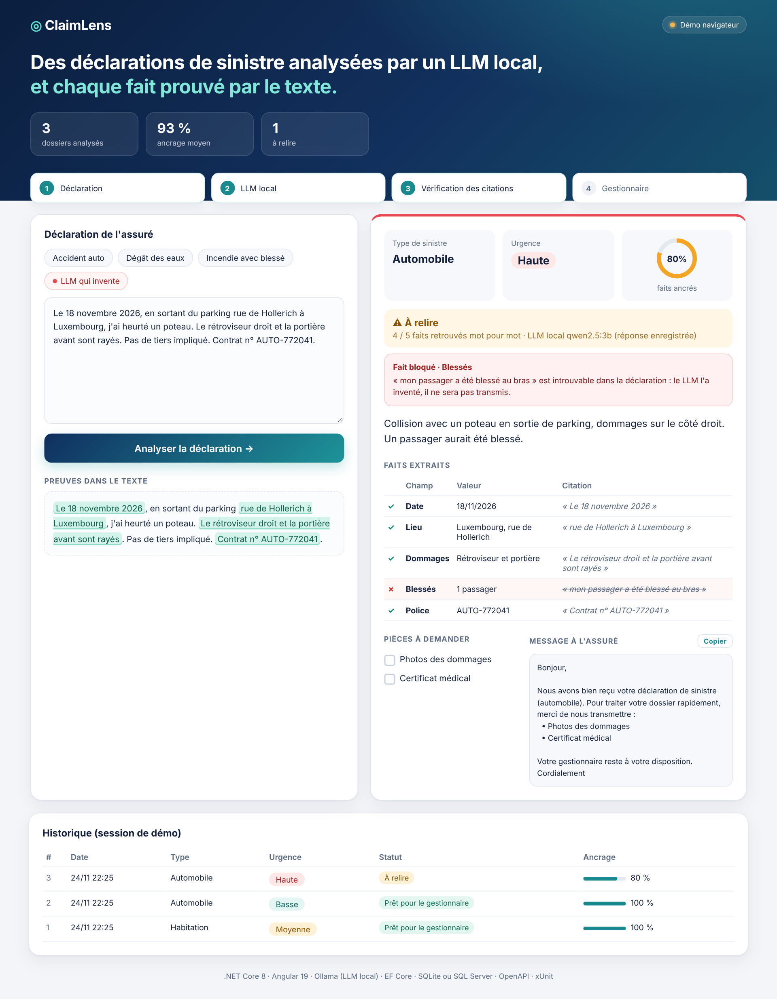

# ClaimLens : analyse de déclarations de sinistre par un LLM local

[](https://github.com/kawtar-bellamine/claimlens/actions/workflows/ci.yml)

Application Full Stack **.NET Core 8 + Angular 19** qui lit la déclaration d'un assuré, la fait analyser par un
**LLM exécuté localement** (Ollama) et prépare le dossier du gestionnaire : type de sinistre, urgence, faits clés et
pièces à demander. Aucune donnée d'assuré ne quitte le poste.

**Le point clé : chaque fait extrait doit citer le texte.** Un vérificateur en C# cherche chaque citation dans la
déclaration (sans tenir compte des accents ni de la casse). Si une citation est introuvable, le fait est marqué ✗ et
le dossier part **en relecture** au lieu d'être transmis : le LLM ne peut pas inventer une date, un lieu ou un blessé.

**Ce que montre la démo :**
- l'exemple **« LLM qui invente »** rejoue une vraie réponse de LLM qui a ajouté un passager blessé : le fait est
  bloqué, barré, et le dossier part en relecture ;
- les citations retrouvées sont **surlignées dans la déclaration** ;
- un **message à l'assuré** listant les pièces manquantes est prêt à copier ;
- un historique avec le taux d'ancrage de chaque dossier.

**Démo en ligne** : [kawtar-bellamine.github.io/claimlens](https://kawtar-bellamine.github.io/claimlens/) (mode
navigateur, moteur de règles ; l'API et le LLM local tournent en local).



## Architecture

```
Angular 19 (signals, standalone)  ──HTTP──▶  API .NET Core 8 (Minimal API, OpenAPI / Swagger)
                                               ├─ OllamaAnalyzer    LLM local, réponse JSON imposée
                                               ├─ RuleBasedAnalyzer secours si Ollama n'est pas lancé
                                               ├─ EvidenceVerifier  garde-fou : citation retrouvée ou fait bloqué
                                               └─ EF Core           SQLite par défaut, SQL Server par configuration
```

| Endpoint | Rôle |
|---|---|
| `GET /api/health` | modèle LLM et base utilisés |
| `POST /api/claims` | analyse, vérifie et enregistre une déclaration |
| `GET /api/claims` | historique des 50 dernières analyses |
| `GET /api/claims/{id}` | déclaration et analyse complètes |

## Lancer le projet

```bash
# 1. LLM local (facultatif : sans lui, le moteur de règles prend le relais)
ollama pull qwen2.5:3b
ollama serve

# 2. API .NET Core (Swagger sur http://localhost:5080/swagger)
cd backend/ClaimLens.Api
dotnet run --urls http://localhost:5080

# 3. Front-End Angular (http://localhost:4200)
cd frontend
npm install
npx ng serve
```

**SQL Server** : dans `appsettings.json`, passer `Database:Provider` à `SqlServer` et renseigner la chaîne de
connexion `SqlServer`.

**Tout en conteneurs** (SQL Server et Ollama) :

```bash
docker compose up -d
docker compose exec ollama ollama pull qwen2.5:3b
cd backend/ClaimLens.Api && dotnet run --urls http://localhost:5080 \
  --Database:Provider=SqlServer --ConnectionStrings:SqlServer="Server=localhost,1433;Database=ClaimLens;User Id=sa;Password=ClaimLens!2027;TrustServerCertificate=True"
```

## Tests

```bash
dotnet test backend/ClaimLens.sln
```

Six tests xUnit : citation retrouvée malgré accents et casse, citation inventée bloquée (dossier « À relire »,
ancrage à 50 %), citation trop courte refusée, classement d'un accident auto avec constat demandé, urgence haute en
cas de blessé, lecture tolérante d'une réponse JSON incomplète du LLM.

## Limites connues

- Le moteur de règles ne sert que de secours : il reconnaît la date, le lieu et le numéro de contrat, pas les
  dommages ni les tiers.
- La vérification prouve qu'une citation existe dans le texte, pas que la valeur en est bien déduite : le
  gestionnaire garde la décision.
- Les déclarations d'exemple sont fictives.
